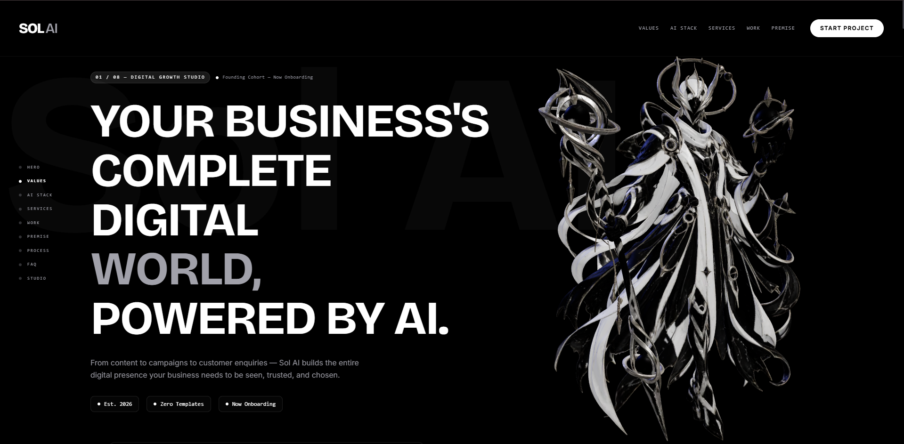
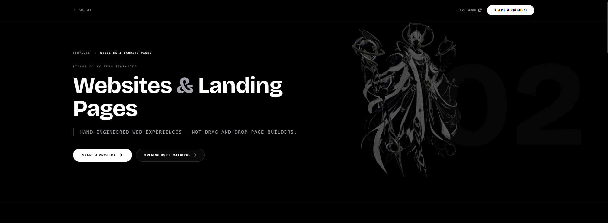
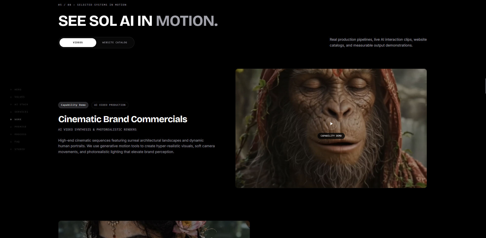
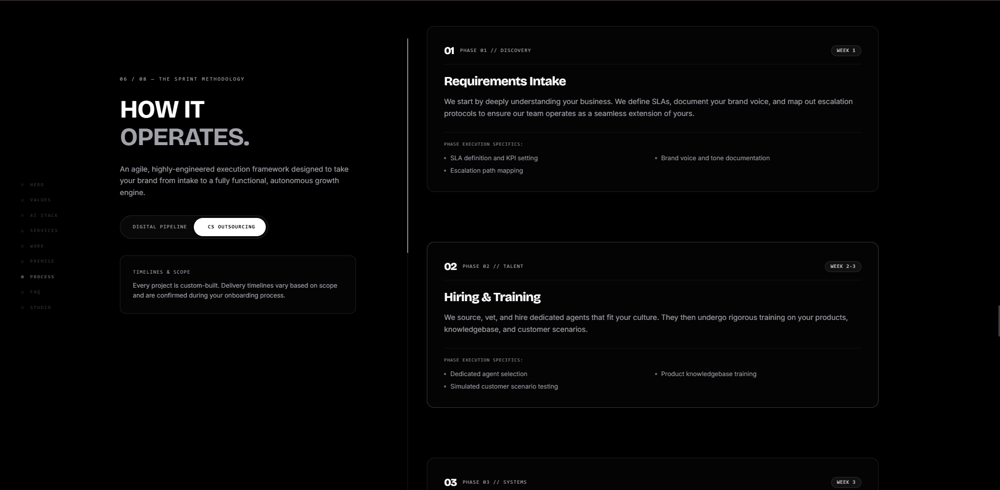
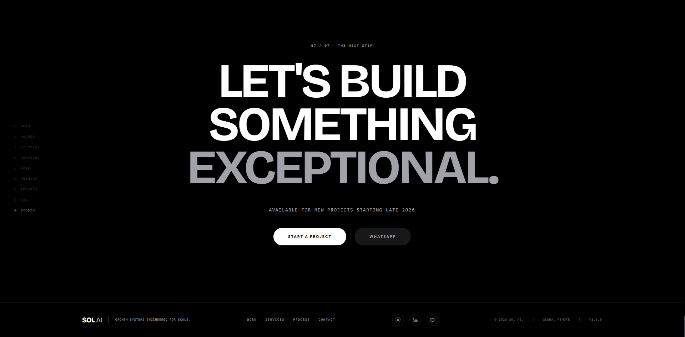
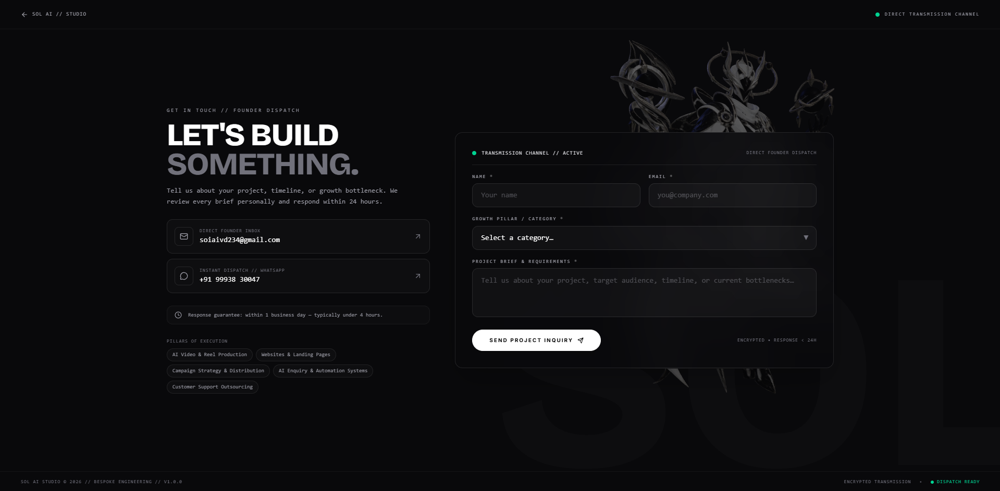

# Sol AI Website

> An AI-powered digital growth studio platform featuring real-time 3D WebGL interactions, dynamic video showcases, and a bespoke monochromatic design system.

---

## 🌐 Live Platform

- **Live URL:** [sol-ai-website-seven.vercel.app](https://sol-ai-website-seven.vercel.app)

---

## 👨‍💻 My Role

**Designed and built the Sol AI website** from concept to production-ready deployment, engineering the UI/UX architecture, 3D WebGL scenes, interactive motion systems, and performant responsive layouts.

---

## 🔒 Source Code & Proprietary Notice

> **Note:** The source code and underlying production codebase for this platform are private company intellectual property (IP) belonging to Sol AI. This repository is maintained strictly for portfolio presentation, architectural showcase, and visual demonstration purposes.

---

## 🛠️ Tech Stack

- **Framework:** Next.js (App Router, Turbopack)
- **3D & WebGL:** React Three Fiber & Three.js
- **Animation & Motion:** GSAP (ScrollTrigger) & Framer Motion
- **Styling:** Tailwind CSS
- **Hosting & Infrastructure:** Vercel (Edge Network & Serverless)

---

## 🎬 Walkthrough Demo

[▶ **Click here to view / download the full walkthrough video**](./demo/solAI_website.mp4)

<video src="./demo/solAI_website.mp4" controls width="100%" poster="./screenshots/01-hero-3d.png">
  Your browser does not support HTML5 video. <a href="./demo/solAI_website.mp4">Download the demo video</a>.
</video>

---

## 📸 Interface & Architecture Gallery

### 1. Hero & Real-Time 3D Interaction

*Interactive 3D model with smooth cursor parallax, scroll-driven rotation, and holographic initialization loader.*

---

### 2. Service Pillar Architecture

*Bespoke capability showcase featuring dynamic deliverables, methodology cards, and direct route synchronization.*

---

### 3. Video Showcase & Media Engine

*Fast-start video showcase featuring automatic intersection playback, instant posters, and categorized previews.*

---

### 4. Sprint Methodology & Operating Pipeline

*Interactive multi-phase sprint roadmap detailing discovery, production, systems integration, and QA cycles.*

---

### 5. High-Impact CTA & Studio Footer

*Monochromatic typography treatment, call-to-action blocks, and verified studio links.*

---

### 6. Single-Viewport Executive Contact Portal

*Non-scrollable 100vh contact portal with live status indicators, category selector, and rate-limited email delivery.*

---

## 📄 License

All rights reserved. Screenshots, visual assets, and content belong to Sol AI. Not licensed for reuse. See [LICENSE.md](./LICENSE.md) for details.
